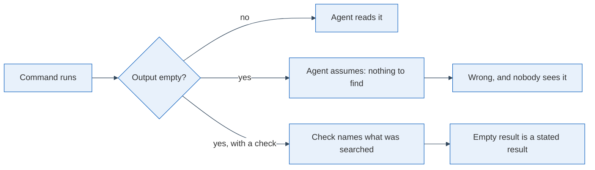

On 18 October an agent read the comments on an issue and found none. It ran `gh issue view 19 --comments`. The command printed nothing and exited 0. The issue had a thread. The agent went on as if nobody had said anything.

A human sees an empty screen and hesitates. An agent sees exit code 0 and moves on.

## Exit 0 with no output is an answer, and it can be wrong

I reproduced it the same day with gh 2.102.0. The text view with `--comments` was empty. The JSON view was not.

```bash
gh issue view 19 --comments        # no output, exit=0
gh issue view 19 --json body,comments   # works
gh api repos/OWNER/REPO/issues/19/comments  # works
```

The risk is not the bug. Tools have bugs. The risk is that a missing maintainer answer and a missing review verdict look exactly like "no maintainer answer yet". The fix is to read threads through the JSON view; I filed the case so the rule has a reason attached when it reaches the agent instructions.

## A grep that finds nothing proves only that the grep is narrow

I pinned every third-party image in my deploy pipeline to a version, so a re-run could no longer change what runs. The issue's acceptance check was one grep that must print nothing. It printed nothing. Then I widened it.

```bash
grep -rnE 'image: [^:]+(:latest)?$' hetzner synology
# exit 1, no output
grep -rnE 'image: [^:]+$|image: .*latest|(VERSION|TAG)=latest' hetzner synology
# exit 1, no output
```

The second pattern also catches `${X:-latest}` defaults and `X=latest` in env files. The first one cannot see those. Both came back empty this time. I only know the second one means it. I put the broad grep into the repo's agent instructions as the check.

## A README is a check too, and it was silent in the wrong direction

An audit of the same repo found documentation that described behaviour the code did not have. The README said a push deploys everything. The workflow deploys one target on push and the rest only on manual dispatch. An application was listed that no compose file ran. An experiment server's README said new users get no permissions. Its compose file gave every user read access to every experiment.

| README said | Compose said |
|---|---|
| `DEFAULT_MLFLOW_PERMISSION=NO_PERMISSIONS` | `DEFAULT_MLFLOW_PERMISSION: READ` |

Nobody noticed because both files were plausible. I decided on no permissions and changed the compose file. Then I ran an architecture audit: 0 services missing from the docs, 0 documented services not in compose. That is a number I can ask for again.

## A rule in a sentence is a check that never runs

I had a rule that replies to me must link every issue and file in full. It sat in the agent instructions as a sentence. Agents broke it regularly. So I moved it into a hook that reads the final reply, blocks the stop once, and lists the bare references it found. A test session blocked "see ADR-009 and #16", accepted the rewrite, and the test file passes 14 of 14 cases.



The diagram is the change. An empty result needs a second line that says what was looked at. "No hits for these three patterns in these two folders" is a result. Nothing is not.

## A link gate that says 404 to a page I can open

My page has a CI gate that fetches every link anonymously with curl. A post I wanted to write links a page on a blogging host. The host answers 404 to curl's default user agent and 200 to a browser one. Every reader can open the page. The gate says it is dead.

I could have given curl a browser user agent. I did not. The gate exists so that what I publish answers to the simplest possible request, and I decided in [personal issue 9](https://github.com/hedata/personal/issues/9) to keep it as it is. Such a link gets described, not linked. The gate is strict in a way I can state in one sentence, and that is worth more to me than one more link.

## What I change next

Every check an agent runs gets one more line in its output: what it searched and how many things it found, even when that is zero. I start with the issue-reading step and the image grep. In two weeks I will count how many agent reports contain a zero that was stated, and how many contain a silence.
