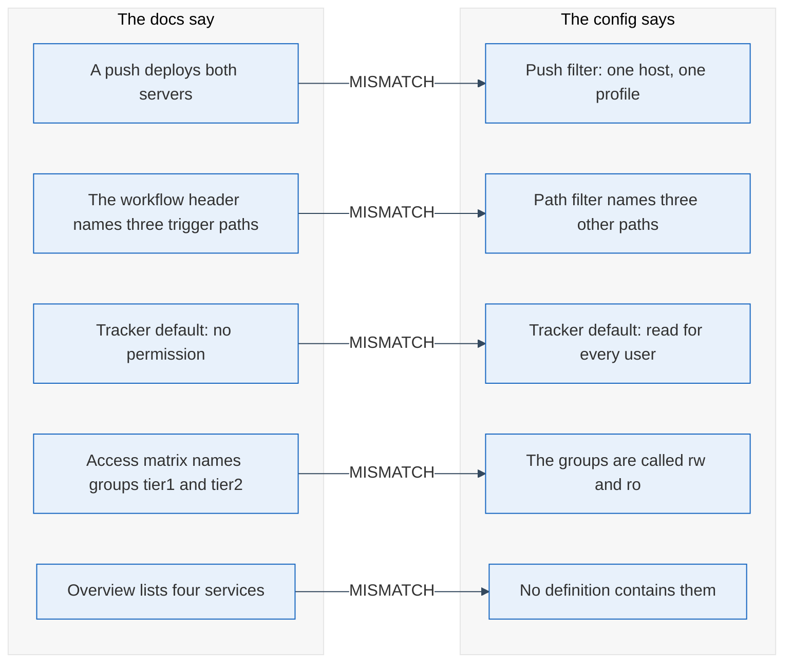

My README said that a new user of the experiment tracker sees nothing until an admin grants access. The deployment said that every user in the group may read every experiment, traces included. The setting had been changed in one place and the sentence had stayed in another.

## Diagrams rot slowly, sentences about behaviour rot fast

When I audited the documentation of one small infrastructure setup this month, I expected stale boxes. There were some: four services the overview still listed that no definition file contained, and two group names that had since been renamed. But most of the damage sat in sentences with a verb in them.

The README said that a push to the main branch deploys both servers. The real path filter of the pipeline deployed one host, one profile, and only when three specific paths changed ([the filter syntax](https://docs.github.com/en/actions/writing-workflows/workflow-syntax-for-github-actions)). A comment in a container definition said a service "always runs", two lines above the line that put it into an optional profile ([profiles are opt-in by design](https://docs.docker.com/compose/how-tos/profiles/)). A helper text said a check ran in CI; the pipeline never called it. Even the workflow's own header comment named different trigger paths than the filter below it.

I think the reason is simple. A box says what exists, and a reviewer notices when the box is wrong. A sentence like "a push deploys everything" says what happens, it is written once from the author's picture of the system, and no later change points back to it.

## Every behavioural claim has one line that decides it

The remedy is not more documentation discipline, which I have never seen survive a busy quarter. It is to treat each behavioural sentence as a test case: find the line in the configuration that decides it, and compare the two.

Read left to right, this is also the audit's output, one row per claim. A row is fixed either by changing the sentence or, as with the tracker permission, by deciding that the configuration was wrong, and a docs audit that finds a security default instead of a typo is a good afternoon's work.

My checklist is read-only: it compares the overview page and the access matrix against the service definitions and prints a report, so it can run after every change.

## A zero is only worth something next to the rows still open

After the fixes, the run reported 0 services missing from the docs, 0 documented services not in the definitions, and 0 mismatches in the table. That does not mean "the docs are correct"; it means the claims the checklist knows how to compare agree.

The same run also found three places where the access matrix still disagrees with the deployment: a dashboard documented as private that is routed publicly behind a password, the groups an application authorizes on, and two applications described as live although they are switched off. That is open, not fixed. One of them is a decision about the system, not the page.

So before your next architecture review, take your overview page and mark every sentence containing "always", "only", "by default", "every" or "on push". Write the file and line that decides each one next to it. Where you cannot find the line, delete the sentence; where the line says something else, you have found your first row, and the list is already the checklist to run again after the next change.
