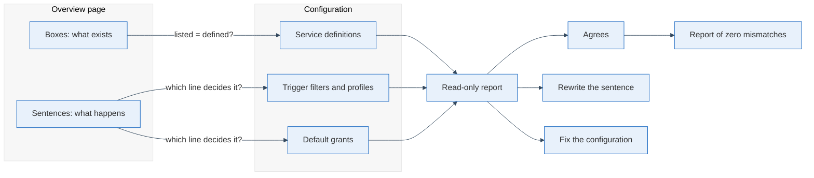

An architecture overview is the one page of a system that new colleagues, clients and future me read first: the boxes, the arrows, and a few sentences on what happens when something changes. I keep one for a small self-hosted infrastructure, a handful of servers and the services on them, because it is the only way I can still answer "what deploys when" after a month away. The diagram is easy to review; the sentences next to it decide whether anyone can trust the page, and nobody tests them.

## Behavioural sentences are the ones worth testing

A box says what exists, and a reviewer notices when the box is wrong. A sentence like "a push to the main branch deploys everything" says what happens. It is written once from the author's picture of the system, and no later change points back to it. I think that is why drift collects there: when I audited this page, four boxes were stale, but the damage that mattered sat in sentences with a verb in them, such as a deploy rule and a default permission.

So I stopped treating the page as prose and started treating each behavioural sentence as a test case. The method has three steps:

1. Mark every sentence that contains "always", "only", "by default", "every", "on push" or a similar verb of consequence.
2. Next to each, write down the one line of configuration that decides it: the trigger filter of a pipeline ([the filter syntax](https://docs.github.com/en/actions/writing-workflows/workflow-syntax-for-github-actions)), the profile a container belongs to ([profiles are opt-in by design](https://docs.docker.com/compose/how-tos/profiles/)), the default grant of a service.
3. Compare the two and record the verdict: agrees, rewrite the sentence, or decide that the configuration is wrong.

The third verdict is the valuable one. A docs audit that finds a security default instead of a typo is a good afternoon's work.

## A good overview page can be diffed against the system

Afterwards the page has a different shape. Every behavioural sentence either carries its deciding line, or it is gone. The boxes are compared by a script that lists the services in the definitions and the services in the page and prints both differences. The sentences are compared by a checklist that only reads files and prints a report, so I can run it after every change.

For a reader this changes what "up to date" means. A newcomer gets a page where "a push deploys one host, when these three paths change" is true because someone checked it against the filter. A reviewer of a configuration change knows which sentences to look at, since each names its line. The owner can answer "is the doc right?" with a number.

## Zero is only worth something next to the rows still open

When the run says 0 services missing, 0 documented services not defined and 0 mismatches in the table, that does not mean the docs are correct. It means the claims the checklist knows how to compare agree. I keep the open rows in the same report, marked as open and not as fixed, so that a zero never has to pretend to be more than it is.

So before your next architecture review, take your overview page and mark the behavioural sentences. Write the deciding line next to each one. Where you cannot find the line, delete the sentence; where the line says something else, you have found your first row, and the list is already the checklist to run again after the next change.
