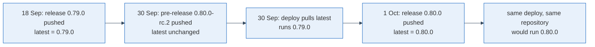

My servers were last deployed on 30 September. Had I run the very same deploy the next morning, with not one line changed in the repository, the VPN server would have come up as a different release, because its maintainers published one in between.
## A floating tag lets the registry decide when you upgrade

An image reference without a version, or with `latest`, is not a version. It is a question the registry answers at the moment you ask, and the answer changes whenever a maintainer publishes. The Compose reference puts it plainly: the default pull policy fetches an image only when it is missing locally, [except that `latest` is always pulled](https://docs.docker.com/reference/compose-file/services/).
My deploy runs a pull every time, and five third-party images floated: three parts of the VPN server on `latest`, a Docker socket proxy with no tag at all, and a WordPress image on `latest`. A re-run with an unchanged repository could replace any of them, and no diff would show it, because the change was never in my repository. I think a deploy that can do this is a lottery with a good-looking pipeline.

## When you cannot look, infer it and say how sure you are

Pinning means writing down the version that runs today; pin to anything else and the pin is itself an upgrade. I had no shell on the server from where I worked, so I could not ask the containers so I used two other methods, with different confidence.

For the VPN's web dashboard I fingerprinted the version. I downloaded the static files of three adjacent releases from the registry, picked files that exist in only one of them, and requested those from the live site. The files unique to one release answered 200, the ones unique to the other two answered 404.
For the server component there was nothing to request, so I dated it. The deploy log gave the time of the last pull, the registry gave the push dates, and `latest` on that day pointed at 0.79.0. A pre-release pushed the same day did not move `latest`, as the project's release workflow confirms. The dashboard fingerprint came from the same pull and agreed. What remains is the assumption that nobody pulled by hand since, and I wrote it into the change as an assumption: if it is wrong, the next deploy rolls those containers back one release.

Beside every pin I recorded how I know: fingerprinted, inferred from dates, or unchanged since long before the deploy. That a re-run now changes nothing stays unverified until someone does a real pull on the server, and I listed it that way.

## A pin tells you what was installed, not what runs

The WordPress image showed me the limit. I pinned it to the version its frozen `latest` had always been, then saw that the public site announces a newer WordPress core than the image contains. Core had updated itself inside the container's volume. The image says 6.8.2, the site runs 6.9.4, and re-creating the container might roll core back. It is tracked, not fixed.

So before your next deploy, list every image reference in your configuration and mark those with no tag or with `latest`. Pin each to the version that runs now, found by asking the container if you can and by dates and file fingerprints if you cannot, and write beside the pin how you know. Then upgrade on purpose, as one change you can read, instead of whenever the deploy happens to run.
