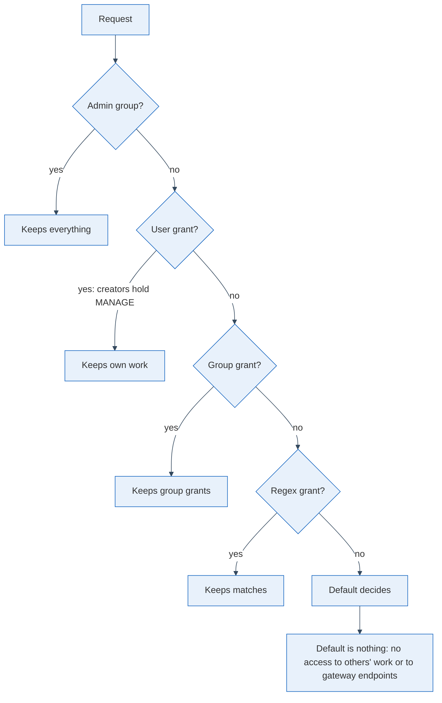

MLflow is an open-source tool for tracking machine learning work: every training run, its parameters and metrics, the models that come out of it and, increasingly, the traces of LLM applications. Teams usually run one MLflow server for several people and projects, so that results sit in one place and can be compared. I run one for that reason. A shared server also raises a question that a personal laptop never does, namely who is allowed to see what.

## The default grant is the answer to every question nobody asked

MLflow's access control is opt-in: you switch on its auth feature at startup, or use a plugin that signs users in through an OIDC identity provider ([MLflow's auth docs](https://mlflow.org/docs/latest/ml/auth/), [the plugin](https://github.com/mlflow-oidc/mlflow-oidc-auth)). Either way, a request is answered by walking a list of sources, the last being the default grant. I think it is the most important line in the configuration, because it governs everything that does not exist yet: every experiment, model and trace created next month, until somebody writes a more specific rule.

In the plugin the first source holding a grant wins, by default in the order user, group, regex, group-regex (an operator can reorder it), and the default applies when none does ([the resolution code](https://github.com/mlflow-oidc/mlflow-oidc-auth/blob/main/mlflow_oidc_auth/utils/grant_context.py)). Since version 7.6.0 that default is no permissions. The docstring of a function in [another file of the plugin](https://github.com/mlflow-oidc/mlflow-oidc-auth/blob/main/mlflow_oidc_auth/utils/permissions.py) explains why that matters: with a default which grants, access "is being handed out by configuration rather than by an explicit permission record". I agree. A good default is no permissions, so that every access is a record somebody made on purpose.

## What a good setup keeps, and for whom

With the default at nothing, each kind of user lands somewhere predictable. The chain below follows one request down to the default.

Admins keep everything; the plugin's docs say they bypass all permission checks. Regular users keep everything they created themselves, since MLflow's docs say the creator of an experiment, a registered model or a gateway resource automatically receives full control (the MANAGE permission) on it. What they do not see is what colleagues created. Everything else is opened deliberately: per user, per group for what everybody may see, or by regex for a family of experiments.

The part that is easy to overlook is the model gateway, MLflow's front door for calling language models through managed endpoints. Endpoints an admin set up resolve through the same chain, so a script or application that calls the gateway with a non-admin account needs a grant too, and without one it gets a permission error far from anywhere a human would look. That is what the source says; I have not watched it happen. Traces make this matter most: they hold whatever users typed, and a default that reads everything shows all of it to the whole group.

## Choose the default first, then grant on purpose

Reading everything is a decision about every person who will ever join the group, so I would make it explicitly or not at all. Granting a few things deliberately is cheaper than finding out later who read what.

So before the next person joins your tracker, read what its default grants and set it to nothing unless you can name why not. Then walk the resolution order once for each kind of user you have, and write down what each keeps: own work, group grants, regex matches, gateway endpoints. That list is your access policy, and it takes less time than the first incident without it.
