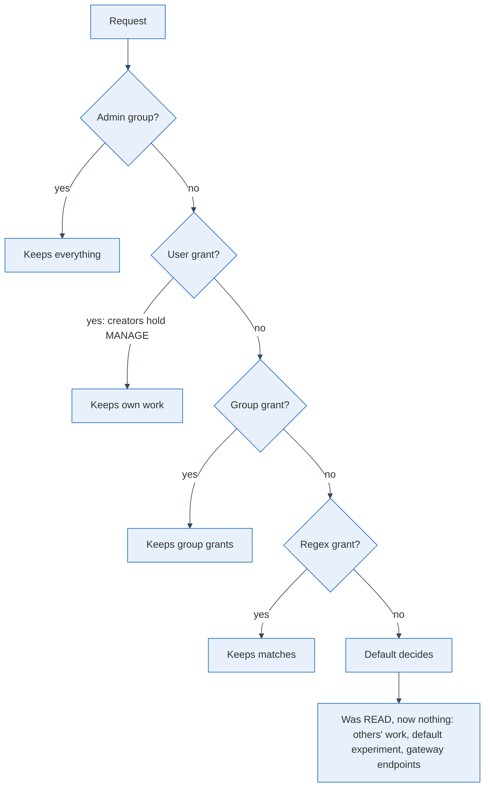

My MLflow server had two descriptions of itself. The README said a new user sees nothing until an admin grants access. The deployment configuration said every member of the login group gets read access to everything. I noticed when I wanted to send an assistant's traces, which would hold private conversations, to the server. The configuration was the one telling the truth.

## The default grant is the answer to every question nobody asked

I think a tracker's default permission is the most important line in its configuration, because it governs everything that does not exist yet: every experiment, model and trace created next month, until somebody writes a more specific rule, which nobody does on the day they create a run.

For the OIDC login plugin I use with MLflow ([MLflow's auth docs](https://mlflow.org/docs/latest/ml/auth/), [the plugin](https://github.com/mlflow-oidc/mlflow-oidc-auth)), the [source](https://github.com/mlflow-oidc/mlflow-oidc-auth/blob/main/mlflow_oidc_auth/utils/grant_context.py) states the order in a docstring: the first source holding a grant wins, in the order user, group, regex, group-regex, and the default applies when none does. A comment in the same code says that since version 7.6.0 the default is no permissions, and that a default which grants means access "is being handed out by configuration rather than by an explicit permission record". Mine granted read: access nobody had decided on.

## Tightening it breaks the people who never held a grant

Setting the default to no permissions is one changed value. The work is finding out who was living off the old one, and I did that against the plugin's source (version 7.3.0, the one I run) because I could not query the production database from where I worked. The chain below is what I found.

Admins lose nothing. Regular users keep everything they created themselves, since the creator receives full control on each new experiment, model and gateway endpoint. They lose read access to all that colleagues created, and to the built-in default experiment, which nobody created and which therefore has no creator grant to fall back on.

The loss I would have missed is the quiet one. Endpoints of the model gateway that an admin set up also resolve through the default. Any script or application calling the gateway with a non-admin account would start to fail after the deploy, with a permission error far away from the line I had changed. I have not seen it happen, since the check after the redeploy is still open; this is what the source says, not what I observed.

## Choose the default first, then grant on purpose

I chose no permissions: reading everything is a decision about every person who will ever join the group, and granting a few things deliberately is cheaper than finding out afterwards who read what. The cost is a to-do list for after the deploy: list the non-admin users and give each what they still need, per user, per group for what everybody may see, or by regex for a family of experiments.

So before the next person joins your tracker, read what its default grants, compare it with what your documentation promises, and if they differ, decide which of the two you meant. Then walk the resolution order once for each kind of user you have, and write down who loses what. That list is the migration, and it takes less time than the first incident without it.
