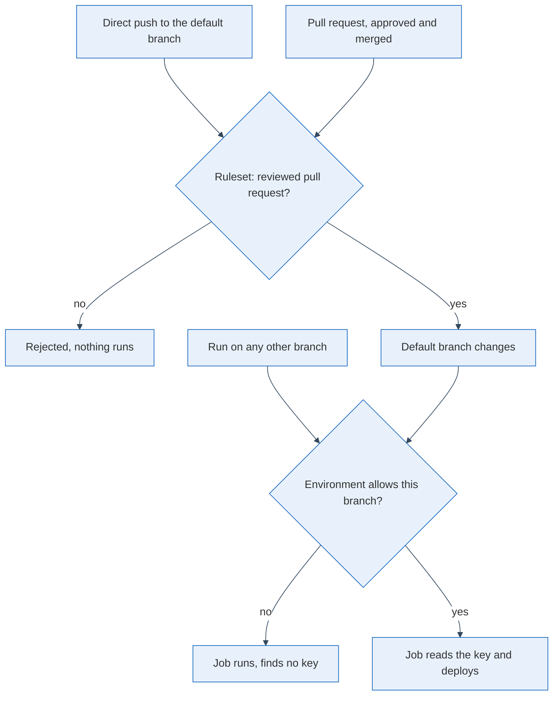

Keeping secrets encrypted in the git repository, with a tool such as [SOPS](https://github.com/getsops/sops), is a popular answer to where the database passwords and API keys of a small service should live: they are versioned like code, and a leaked repository leaks only ciphertext. I run my own servers this way, with a CI deploy job that decrypts the files and rolls the result out on every merge. Whether this is secure is decided outside the cryptography, by one question: which runs of that job get to hold the key?

## The key belongs to a path, not to a repository

The cryptography held up when I audited my setup. What I had underestimated is the deploy job: it receives the decryption key, decrypts everything on the runner and then runs code from the repository. Anyone who can get a commit into the branch that triggers it, such as an agent or a compromised workstation, reaches every secret with one push. GitHub's [guidance on secure use](https://docs.github.com/en/actions/reference/security/secure-use) points the same way: a workflow does with its secrets whatever its code says.

So I stopped asking where the key is stored and asked which paths lead to a run that can read it.

Only one path ends in a job that holds the key: a pull request somebody approved, merged into the default branch. Two parts of the platform make that true. A ruleset on the default branch requires a pull request with an approving review, so a direct push never lands. And the two deploy secrets live in a deployment environment whose [deployment branch policy](https://docs.github.com/en/actions/how-tos/deploy/configure-and-manage-deployments/manage-environments) allows only the default branch. A run from any other branch finds no key, and a run from the default branch exists only because the ruleset let a reviewed change in.

## Make the merge the deploy trigger

Environments also offer required reviewers, a second human click before each deploy, on a more expensive plan. I decided against it: the merge is already the deploy trigger, and under the ruleset the merge is a human act, so a second click on the same change adds a delay, not a check.

Where the platform offers no such gate there is a fallback, which I designed first: a check in the workflow, before checkout and decrypting, that asks the GitHub API whether every commit since the last good deploy came in through a merged pull request, and fails closed otherwise. It exists as a written decision and was never built. I had ruled out the paid plan, which private repositories need for rulesets, and spent a design working around that before reversing the call four days later. A check inside the file it guards is only as good as access to that file; a ruleset sits outside it.

As of today the ruleset and the environment exist, and the workflow reads both secrets from the environment. I have not watched a first deploy under it, nor confirmed that the old repository-level copies of the two secrets are gone; until they are, the setup protects less than the diagram claims.

## What to check tomorrow

Ask of your deploy workflow which events start a run that holds the decryption key, whether a commit can reach that branch without a reviewer, and whether the key is a repository secret any branch can read. If the answers are "any push", "yes" and "yes", the encryption protects you from a leaked clone and from little else. Move the key into an environment restricted to the default branch, require review on that branch, and delete the old copy of the key, in that order.
