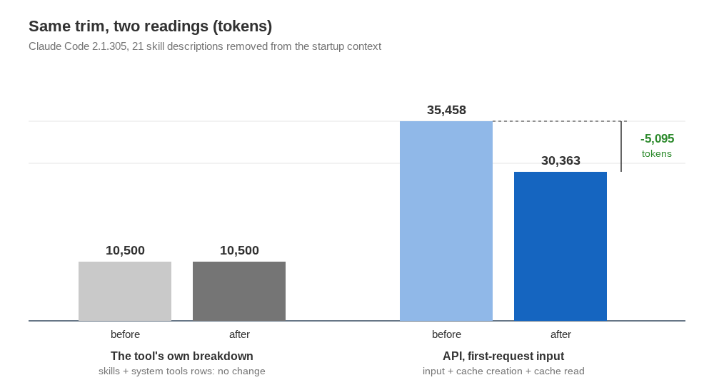

Claude Code is Anthropic's coding agent, which you run from a terminal. Before it reads your first word it has already loaded a system prompt, its built-in tool definitions, any tool definitions from connected servers, your instruction files and a listing of skills, which are slash commands with a one-paragraph description each. I run it unattended: every work item starts a fresh session through automation, so that startup context is paid again on every run, and a run's first request carried about 57,000 input tokens before I touched anything. That makes the startup context a budget line, and a budget line needs a number you can trust. I stopped trusting the tool's own breakdown after one trim.

## The tool's breakdown can re-file a saving instead of showing it

The tool has a `/context` command that prints how much each contributor takes: system prompt, system tools, MCP tools, memory files, the skills listing, custom agents, and a total ([the costs page](https://code.claude.com/docs/en/costs) points to it for exactly this). I used it to plan the trim. Twenty-one skills, 13 synced from the web app and 8 bundled with the tool, got switched to name-only through a settings override, so each stays listed and invocable while its description leaves the startup context. One unused plugin was disabled and my instruction file shrank by about 0.6k tokens. Then I ran `/context` again. The skills listing had dropped from 7.4k to 2.7k, but system tools had grown from 3.1k to 7.8k. In that version of the tool a name-only skill is counted under system tools, so the two rows together read 10.5k before and 10.5k after, and the total moved only by the shortened instruction file.

The breakdown is not lying; where a heading files things is simply somebody's decision. The figure shows the same trim read two ways.

## The API's usage field is the number to budget with

The API reports what it was actually sent. For a request, the total input is `input_tokens + cache_creation_input_tokens + cache_read_input_tokens`, which [the prompt-caching documentation](https://docs.anthropic.com/en/docs/build-with-claude/prompt-caching) gives as the formula for total input tokens. The tool's JSON output carries those three fields, so a measurement is one command: run the tool once with a minimal prompt such as "Reply with the single word ok." in print mode with JSON output, and add the three numbers. I did that three times before and three times after, on Claude Code 2.1.305 with the default model. All three samples were identical each time. With the web app's connectors connected the first request went from 35,458 to 30,363 tokens, and with no MCP servers at all from 30,207 to 25,112. Both rows save 5,095 tokens.

Anthropic also offers [a token-counting endpoint](https://docs.anthropic.com/en/docs/build-with-claude/token-counting), but its page calls the result an estimate that may differ slightly from the tokens used when the message is created. For a budget I prefer the count from a real request: it is what the request actually carried, and it works on the whole startup context, including the parts you did not write.

The honest caveat is that this clean number exists only in the controlled setting. After the change, two real automated runs started with 59,682 and 55,871 tokens, against 60,689 before, which is 1.0k and 4.8k less. They differ from each other by 3.8k although their settings are identical, because their prompts differed. In production traffic the saving is real and buried in prompt variation, and I would not have found it there.

## Budget with the usage field of a fixed prompt

If you budget tokens for an application, take your measurement from the API's usage fields on a fixed minimal prompt, with a few repeats to see whether the samples agree. Run it with and without your change, and keep the per-contributor breakdown for deciding where to cut, not for checking the cut. Where a breakdown and the API disagree, believe the API.
