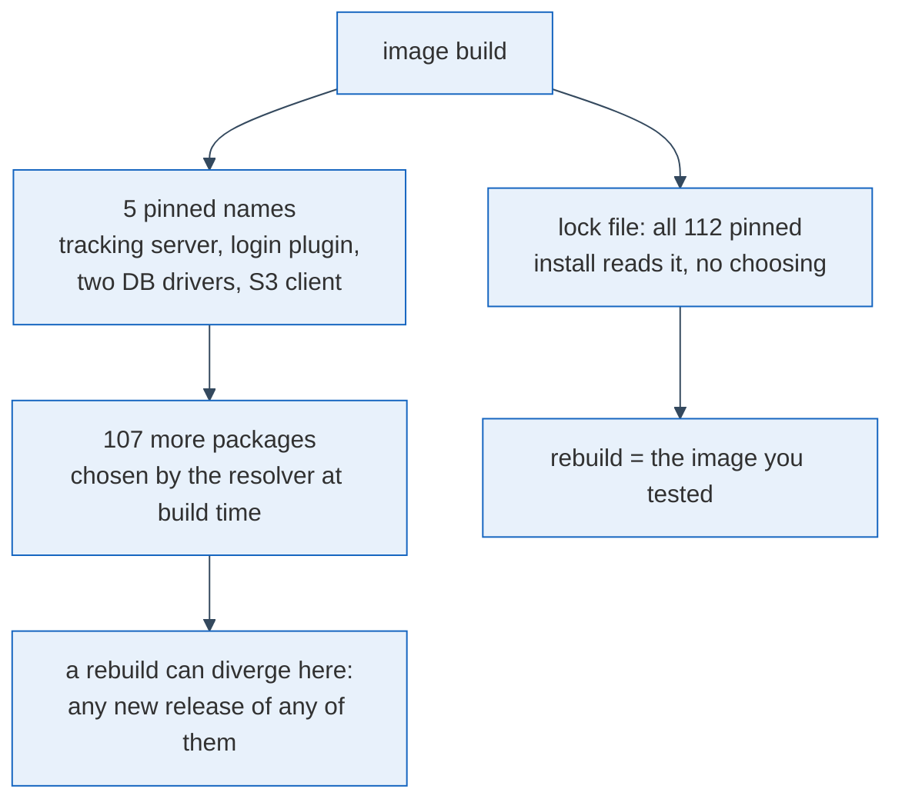

MLflow is an open-source tool that records machine-learning runs, models and metrics. I run one tracking server for all my projects, so results sit in one place and can be compared, and I build it as a container image: the upstream MLflow image plus one `pip install` line that adds a login plugin, a PostgreSQL driver and an S3 client for the artifact store. A server that several people depend on raises a plain question: if I rebuild the image next month from the same commit, do I get the image I tested? I think that for many Python images the answer is no, and that pinning the headline package is what hides it.

## A pin covers one name, the resolver chooses the rest

When I audited that Dockerfile against my own rule, "two builds of the same commit produce the same image", two of the packages in the install line had no version at all. I fixed that on 31 October by adding build arguments with exact versions, the same way the MLflow version and the login plugin were already pinned.

To see what was still open, I asked the resolver what a fresh install would contain, using `uv pip install --dry-run` on Python 3.11, the upstream base. It printed `Resolved 112 packages`. I had pinned five of them. The other 107, among them the AWS client library behind the S3 client and the SQL toolkit under the server, were still picked by the resolver on the day of the build.

The diagram is the claim: a pin fixes a node, and the divergence happens in the layer below it. Every name in that layer has its own maintainers and its own release calendar, and a release of any one of them is enough to change what your next build ships. Nobody sees it in a diff, because the diff is the repository and the change is on a package index.

## The whole tree belongs in a file you review

The fix that matches the claim is a lock file: resolve once, write all 112 names with exact versions into a constraints file, commit it, and make the Dockerfile install under it. With uv that is `uv pip compile`, described in the [uv documentation](https://docs.astral.sh/uv/pip/compile/); with plain pip it is a [constraints file](https://pip.pypa.io/en/stable/user_guide/#constraints-files) passed with `-c`. Upgrading then becomes an act: regenerate the file, read the diff, rebuild, test. An update to the AWS library shows up as a line in a pull request instead of a surprise on the server.

I have not done this yet. What exists today is the five pins and the dry run that proves they resolve together without a conflict; the image has not been rebuilt under them, and I could not read the versions of the running one, so I took the newest compatible release of each. That is a guess dressed as a pin, and the lock file is what turns it into a record.

Who gains? The person on call, who can say what is running without asking the internet, and the data scientist whose experiment broke on Tuesday after working on Monday, who can rule out a new library.

So tomorrow, take your most important image and run a dry-run resolution against it. Compare the number it prints with the number of versions you wrote down. If the first is larger, and it will be, the difference is the part of your image that you have not chosen.
