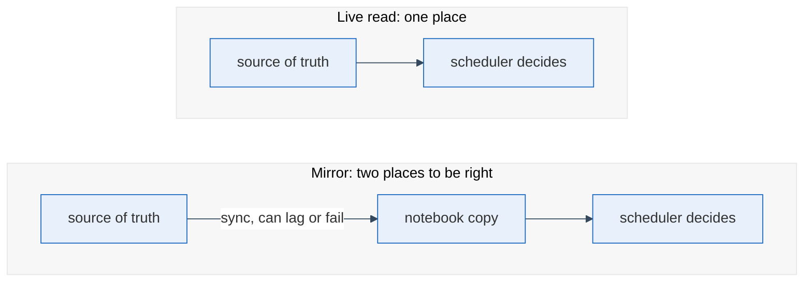

I run a small scheduler: once an hour it looks at the GitHub tickets I have marked ready and starts an AI coding-agent run on each, at most three at a time. A run implements one ticket and opens a pull request that a second agent reviews. A scheduler must know what is already running, and mine kept that in a notebook of its own, one pinned ticket per project, synced against GitHub on every fire by a script. I now think that was the wrong design, and not only for schedulers: a copy of another system's state is a liability the moment the two can disagree, and they will.

## The mirror only needs to be wrong once

On 30 October the loop claimed three slots and started three runs. All three pull requests merged within half an hour. The sync then dropped the run lines as finished, but the start script ignored a claim only while a run line for its ticket existed, so the three claims counted again until a ninety-minute window expired. The next fire printed "slots: 3 of 3 held" with nothing running.

The first fix was a patch: a claim stops counting once a later start line exists, or the ticket is closed. It worked, and it was one more rule inside the mirror, which is how mirrors grow: each rule repairs a disagreement the last one did not foresee.

My decision record weighed three options. Keep the notebook and fix its bugs, leaving the sync script, its tests and its failure modes. Move it into a file in the repository, which is the same sync problem plus a commit every hour. Or read every fact live and delete the notebook. The record's argument for the third was that every fact in the notebook already had a live source: a run in the routine API, a pull request and its review status on GitHub, a question for me as a review request.

## A slot is a label on the thing itself

I chose the third option, and its rule travels well: put the claim on the object being claimed. Before a run starts, the start script moves the ticket's label from "ready" to "running", and a slot is a ticket labelled running. The label comes off when the run's pull request has a review verdict, or its draft is open, or its session has ended, in which case "ready" returns.

Whoever operates the system sees the labels the scheduler sees, so "why did nothing start?" is answered on the board, not in a script's private notebook. Whoever maintains it has about 500 lines and a 261-line test file fewer, one step fewer per fire, and no copy to drift. The bug was not fixed; it stopped being possible.

## What you pay, and what I have not checked

Each fire now reads the running and ready tickets of every repository instead of one notebook ticket per project, and the history of starts is the [label timeline](https://docs.github.com/en/rest/issues/timeline), summarised weekly. The record also states an assumption I have not verified: that labelling is atomic enough for two starters a minute apart to see each other's label. The loop and a manual start never run in the same minute today, which is not the same as being safe. I have no measurements of the change either; it merged on 31 October.

So tomorrow, list where a service of yours keeps a status that another system also knows. For each, ask whether its reader could read the original instead. Every yes is a deletion, and a tracker's [labels](https://docs.github.com/en/issues/using-labels-and-milestones-to-track-work/managing-labels) are a fair place to look for a new home for a claim.
