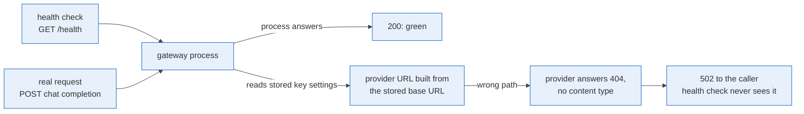

MLflow is an open-source tool that records machine-learning runs, models and metrics, and newer versions include an AI gateway: one HTTP endpoint that forwards OpenAI-style chat requests to a model provider such as Anthropic, using API keys the server stores for it. I run one MLflow server for all my projects, so every application talks to one gateway and the provider keys live in one place instead of in every app. That puts one component in front of every model call, so its health check is the signal everybody trusts. I think that signal is usually measuring the wrong thing.

## A green liveness check only says the process is up

After a weekend upgrade of the server (3.12.0 to 3.17.2), the health endpoint answered 200, as it had before. A chat endpoint on the gateway answered 502 on every call, text and image requests alike, and it had worked the day before. No dashboard I had showed the second fact.

That is not a bug in the health endpoint. The Kubernetes documentation on [liveness, readiness and startup probes](https://kubernetes.io/docs/tasks/configure-pod-container/configure-liveness-readiness-startup-probes/) describes a readiness probe as the way to detect that an application is temporarily unable to serve traffic, and says the readiness and liveness probes do not depend on each other. A process can be alive and still unable to do the one thing it exists for.

The probe stops at the process; the request continues into configuration and the provider, where everything that can break is invisible to the probe.

## The trace of a failed call is where the answer is

The 502 itself told me nothing. Cloudflare, which sits in front of the server, replaced the body with its own "error code: 502" page, and the server log held one line saying a POST returned 502. The reason was in the gateway's call log. An endpoint with usage tracking writes every call, failed ones too, as a trace into an MLflow experiment. Every call from the day before the upgrade had state OK; every call after it had state ERROR. The span for the provider call held the exception: the route service received a response whose content type was None.

The new version builds the provider URL from the base-URL field of the stored key, which the old version had ignored. Mine held the bare provider host, without the `/v1`, so the gateway asked for `/messages` directly under it. An anonymous request confirms it: that path answers 404 with no content type header, while the path in the [Messages API documentation](https://docs.anthropic.com/en/api/messages) lives under `/v1`. An admin changed the field in the MLflow interface, and a text call and an image call both returned 200 with a model answer.

What exists today is one runbook line, to make a call on every gateway endpoint after an upgrade, and one troubleshooting entry: on a gateway 502, read the span exception of the latest ERROR trace first. Both depend on a person remembering them.

## Make the check do what the user does

The step I have not built is a synthetic request: a small scheduled job that sends one cheap chat call per endpoint, through the same front door as real traffic, and fails on anything but a model answer. Its failures would page you. I would keep the liveness probe, since restarting a dead process is its job, but not let it stand for the feature.

So tomorrow, take the service whose health endpoint you trust most and ask which request your users send that it never sends. Write that request down, make it once by hand after your next upgrade, and when it fails, read the trace before the error page.
