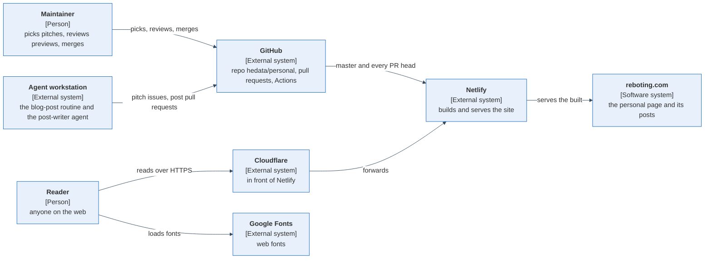
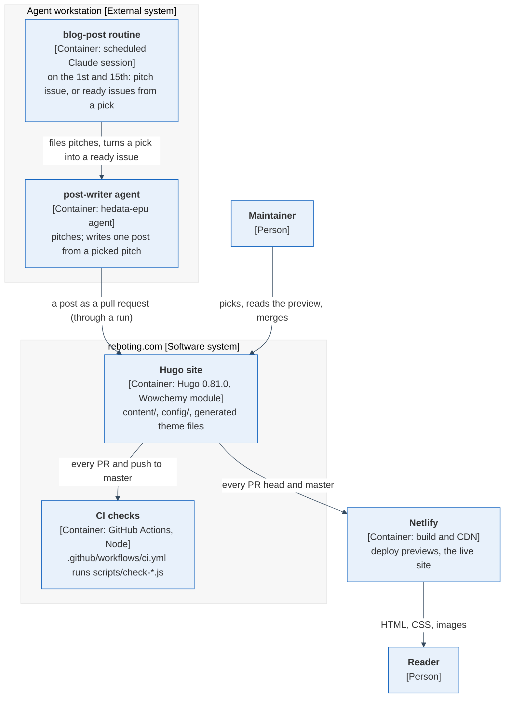

# reboting.com — architecture

This page says how the site and the way posts reach it are shaped, in [arc42](https://arc42.org/overview)'s twelve sections with [C4](https://c4model.com/) diagrams ([core ADR-008 — one architecture and production-readiness standard](https://github.com/hedata/vault-projects/blob/main/20-Projects/core/decisions/ADR-008-architecture-and-readiness-standard.md)). It links the other pages rather than copying them: what the site is and how to work on it is in [`README.md`](../README.md); the layout, every command, the CI gates in detail, the after-merge step and the conventions are in [`AGENTS.md`](../AGENTS.md); where the design tokens come from and how a new version is taken is in [`design/README.md`](../design/README.md). When code and these pages disagree, one of them is a bug.

Which page a PR changes: a PR that changes a command, a gate or a convention updates `AGENTS.md`; this page changes only when the structure changes (a container, the stage, the deployment, the gap list in section 11). The decision records and the project record linked here are kept in a private repository; their links answer only to the maintainer.

## 1. Introduction and Goals

reboting.com is the maintainer's public personal page: a static site with short posts on running software, each with a diagram or a picture ([`README.md`](../README.md), first paragraph). Posts come out of the maintainer's projects: an agent pitches, the maintainer picks, an agent writes the post as a pull request, the maintainer's merge publishes it.

The goal it is judged against is the EPU [project record](https://github.com/hedata/vault-projects/blob/main/20-Projects/epu/project.yaml): "Have my professional life presentable", and for now "A post every two weeks from the routine". This repo is the first of that project's repos, so its Context diagram (section 3) is the project's one.

Quality goals:

1. **Nothing private on a public page.** The repo and the site are public; a post never names private projects, people, hosts or addresses, and links only to public repositories — checked by scripts in CI, not only by the writer's prompt ([EPU ADR-002](https://github.com/hedata/vault-projects/blob/main/20-Projects/epu/decisions/ADR-002-personal-page-content-routine.md)).
2. **Publishing is the maintainer's merge.** Nothing reaches `master`, and so the live site, without a pull request the maintainer approved ([core ADR-007](https://github.com/hedata/vault-projects/blob/main/20-Projects/core/decisions/ADR-007-github-enforces-merge-gates.md)).
3. **Every picture has its source.** Diagrams are Mermaid text, every other picture is checked in next to what it was made from ([EPU ADR-003](https://github.com/hedata/vault-projects/blob/main/20-Projects/epu/decisions/ADR-003-diagrams-and-pictures-as-source.md)).
4. **The look is derived, never forked** from the design tokens of the hedata-epu design skill ([EPU ADR-001](https://github.com/hedata/vault-projects/blob/main/20-Projects/epu/decisions/ADR-001-design-source-and-publishing.md), [`design/README.md`](../design/README.md)).

Stakeholders: the readers of reboting.com; the maintainer (picks pitches, reviews deploy previews, merges); the agents that write and check posts (the blog-post routine, the post-writer agent, the implementer and reviewer agents of a run).

## 2. Architecture Constraints

Stage: production

- **Stage production** (core ADR-008): the site serves the public. Its proposed starting stage in core ADR-008 is production, "a public static site, most items not applicable with a reason" (section 11).
- **A public repository.** Anything committed here is public, this page included: no private name, host, address or credential; private repositories are described, not linked, in posts (`scripts/public-repos.txt`, `scripts/forbidden-words.txt`).
- **Pinned build:** Hugo 0.81.0 extended on Netlify ([`netlify.toml`](../netlify.toml)); the Wowchemy theme as a Hugo module pinned in [`go.mod`](../go.mod) and `go.sum` to a commit of 2021-03-06.
- **Default branch `master`**, not `main`. Its ruleset takes changes only by a pull request with one approving review, no bypass actors (core ADR-007; ruleset "main: PR + 1 approval (core ADR-007)", read 2026-11-02).
- **Checks are plain Node without dependencies** (`scripts/`), tested with `node --test`.
- **Generated files are never edited by hand**: the theme files come from `design/tokens.json` through `scripts/generate-theme.js` ([`AGENTS.md`](../AGENTS.md), "Layout" and "Conventions").

## 3. Context and Scope

The site is one software system. Readers reach it through Cloudflare and Netlify; the maintainer and the agents change it only through GitHub.

reboting.com answers through Cloudflare (response header `server: cloudflare`) in front of Netlify's edge (`cache-status: "Netlify Edge"`), observed 2026-11-02 19:51 CET; the Cloudflare and DNS settings are not in this repo. Every page loads its fonts from `fonts.googleapis.com` (same observation); no analytics, comments or contact form are switched on (`config/_default/params.yaml`, `content/home/contact.md`).

In scope: the site's source, its build and deploy, the CI gates. Out of scope here: the blog-post routine (a prompt in the core repo) and the post-writer agent and design skill (the hedata-epu plugin in agent-control) — they are drawn as containers in section 5 because posts reach the site only through them, and described on their own repos' pages.

## 4. Solution Strategy

- **A static site, no server of our own.** Hugo builds HTML from markdown; Netlify serves it. Nothing runs between requests, so most of the bar's runtime items do not apply (section 11).
- **Every change is a pull request with a preview.** Netlify builds each PR into a deploy preview, the maintainer reads it, merging to `master` deploys ([EPU ADR-002](https://github.com/hedata/vault-projects/blob/main/20-Projects/epu/decisions/ADR-002-personal-page-content-routine.md)).
- **What must not happen is a script in CI**, not a line in a prompt: forbidden words, public links only, a picture per post, a featured image with its source, generated files untouched, this page's shape ([`AGENTS.md`](../AGENTS.md), "CI").
- **Pitch → pick → write.** The routine has the post-writer pitch three topics, the maintainer picks, and only a picked pitch becomes a post, built by an ordinary run from a `ready` issue (section 6).
- **The look is generated** from a copy of the design tokens ([`design/README.md`](../design/README.md)).

## 5. Building Block View

### Containers

No container has an inside a reader cannot see from this diagram and the layout below, so there is no Component diagram (core ADR-008 rule 2).

| Container | Where | What it does |
| --- | --- | --- |
| Hugo site | `content/`, `config/_default/`, `assets/`, `static/`, `data/`, [`go.mod`](../go.mod) | The pages and posts; the theme is a Hugo module. Layout in [`AGENTS.md`](../AGENTS.md), "Layout". |
| CI checks | [`.github/workflows/ci.yml`](../.github/workflows/ci.yml), `scripts/` | The gates; which runs on the whole tree and which on changed posts only: [`AGENTS.md`](../AGENTS.md), "CI". |
| Netlify | [`netlify.toml`](../netlify.toml) and the Netlify site `reboting` | Builds `master` into the live site, each PR into a deploy preview, and posts the status `netlify/reboting/deploy-preview` on the PR's head. |
| blog-post routine | core repo, `routines/blog-post.md` | Twice a month on the workstation: a pitch issue (label `pitch`), or one `ready` issue per picked pitch. Never writes a post or opens a PR. |
| post-writer agent | agent-control repo, plugin `hedata-epu` | Mode pitch and mode write; reads `scripts/check-*.js` and runs them on its post. |

Also in the repo: [`.github/workflows/pr-assign.yml`](../.github/workflows/pr-assign.yml) assigns every PR to the maintainer and requests their review; `scripts/generate-theme.js` makes the theme files from [`design/tokens.json`](../design/tokens.json).

## 6. Runtime View

**A post, from pitch to live.** The routine's run on the 1st or 15th finds no open pitch issue and has the post-writer file one with three pitches. The maintainer replies with a number. The next routine run turns the pick into a `ready` issue; the hourly manager loop starts a run from it, which has the post-writer write the post into `content/post/<date>-<slug>/` on a branch and opens a pull request. On the PR: CI runs the gates, Netlify builds the deploy preview, the reviewer agent posts its verdict, `pr-assign.yml` puts it in the maintainer's inbox. The maintainer reads the preview and merges; Netlify builds `master` and publishes.

**A change to the look.** A new token version is copied into `design/tokens.json`, `scripts/generate-theme.js` is re-run, all of it is one PR; CI fails if a generated file differs from what the tokens give ([`design/README.md`](../design/README.md)).

**A page view.** The reader's browser asks Cloudflare, which forwards to Netlify's edge, which serves the built file; the page then loads its fonts from Google Fonts. Nothing of ours runs.

## 7. Deployment View

| Environment | What runs where | How it moves |
| --- | --- | --- |
| deploy preview | Netlify builds the PR head (`hugo --gc --minify --buildFuture`, [`netlify.toml`](../netlify.toml)) at a preview URL of the site `reboting` | On every push to a PR. |
| production | Netlify builds `master` (`hugo --gc --minify`, `HUGO_ENV=production`) and serves it as reboting.com, behind Cloudflare | On every merge to `master`; nothing else is run after merge ([`AGENTS.md`](../AGENTS.md), "After merge"). |
| CI | GitHub Actions, Node 22, [`.github/workflows/ci.yml`](../.github/workflows/ci.yml) | On every PR and push to `master`; builds nothing, deploys nothing. |

**Rollback.** Revert the merge on `master` by a pull request (`git revert <sha>`); Netlify builds and publishes the reverted `master`. Netlify also keeps earlier deploys that its dashboard can publish again; that path needs the maintainer's Netlify account and was not tried from here.

**What costs money, per environment** (core ADR-008 rule C1):

| Environment | Item | Price | Source |
| --- | --- | --- | --- |
| CI | GitHub Actions on standard GitHub-hosted runners | free in a public repository | GitHub's "About billing for GitHub Actions", read 2026-11-02: "The use of standard GitHub-hosted runners is free: In public repositories" |
| deploy preview, production | The Netlify site `reboting` | not written (section 11) | — |
| production | Cloudflare in front of the site; the domain reboting.com | not written (section 11) | — |
| — | The routine's and the post-writer's model use | in the sessions of the agent workstation, written on the core and agent-control pages, not here | — |

## 8. Cross-cutting Concepts

**Public by default.** The repo, the site and the pull requests are public. Posts are checked for forbidden words (a public list in the repo and a private one in the repository secret `POST_FORBIDDEN_WORDS`, never printed) and for links that answer anonymously and point only at public repositories ([`AGENTS.md`](../AGENTS.md), "CI").

**Diagrams and pictures as source.** Mermaid in the post (Wowchemy renders it with `diagram: true` in `config/_default/params.yaml`); a featured image with its source next to it ([EPU ADR-003](https://github.com/hedata/vault-projects/blob/main/20-Projects/epu/decisions/ADR-003-diagrams-and-pictures-as-source.md)). The diagrams on this page start with the design skill's theme line too.

**Design tokens.** One source, the hedata-epu plugin; this repo keeps a copy and generates from it ([`design/README.md`](../design/README.md)).

**Config and secrets.** Build settings in [`netlify.toml`](../netlify.toml), site settings in `config/_default/`; the only secret is `POST_FORBIDDEN_WORDS`, a GitHub repository secret. The workflows ask for the least they need: `ci.yml` `contents: read`, `pr-assign.yml` `pull-requests: write` and `issues: write`.

**Logging and tracing.** Not applicable: no process of our own runs; the only logs are Netlify's build logs and the CI logs.

**Test strategy.** Unit tests of every check under `scripts/test/` (`node --test "scripts/test/*.test.js"`, offline: links are served by a local server; diff-based gates run in a throw-away git repository); the Netlify deploy preview is the build test with the real Hugo and the real theme on every PR; the maintainer's reading of the preview is the visual review.

**What enforces the shape.**

| Rule | Check | Where |
| --- | --- | --- |
| The generated theme files are what the tokens give | `node scripts/generate-theme.js --check design/tokens.json` | `scripts/generate-theme.js`, CI step "Theme files are generated from the tokens" |
| This page has arc42's twelve sections in order, `Stage:` first in section 2, a Mermaid block with the theme line in sections 3 and 5, and every relative link under `docs/` resolves | `node scripts/check-architecture-page.js` | `scripts/check-architecture-page.js`, `scripts/test/check-architecture-page.test.js`, CI step "Architecture page" |
| The post gates (front matter, forbidden words, public links, a picture, a featured image with its source) | `scripts/check-*.js` | [`AGENTS.md`](../AGENTS.md), "CI" |

## 9. Architecture Decisions

The decisions are records in the project wiki; this list links them and copies nothing.

- [EPU ADR-001 — the design system is a skill in agent-control; Claude Design mirrors it](https://github.com/hedata/vault-projects/blob/main/20-Projects/epu/decisions/ADR-001-design-source-and-publishing.md)
- [EPU ADR-002 — posts are written by a routine and shipped as pull requests through CI](https://github.com/hedata/vault-projects/blob/main/20-Projects/epu/decisions/ADR-002-personal-page-content-routine.md)
- [EPU ADR-003 — diagrams are text, every picture has its source](https://github.com/hedata/vault-projects/blob/main/20-Projects/epu/decisions/ADR-003-diagrams-and-pictures-as-source.md)
- [core ADR-007 — GitHub enforces the merge gates](https://github.com/hedata/vault-projects/blob/main/20-Projects/core/decisions/ADR-007-github-enforces-merge-gates.md)
- [core ADR-008 — one architecture and production-readiness standard](https://github.com/hedata/vault-projects/blob/main/20-Projects/core/decisions/ADR-008-architecture-and-readiness-standard.md)

## 10. Quality Requirements

- **Recovery (RPO, RTO).** The whole site is the source in git on GitHub; any commit of `master` rebuilds it. RPO: the last merged commit. RTO: one Netlify build, not measured. What git does not hold is in section 11.
- **Load and stress targets.** Not applicable: static files served by Netlify's CDN behind Cloudflare; no server of our own whose load we set or test.
- **Availability (SLO).** None set yet (section 11).
- **Cost per unit of use.** Not applicable: no metered cost per page view or per reader is known (section 11, cost row).

## 11. Risks and Technical Debts

The gap list against [core ADR-008](https://github.com/hedata/vault-projects/blob/main/20-Projects/core/decisions/ADR-008-architecture-and-readiness-standard.md)'s bar: every item owed at stage production that this repo does not meet, as of `master` at c19fca4 (2026-11-01). Each becomes its own issue.

| Bar item (pillar) | What is missing |
| --- | --- |
| SAST, dependency (SCA) and secret scans in CI (Security) | `ci.yml` runs none. GitHub's secret scanning and push protection are disabled, and so are Dependabot security updates (`security_and_analysis` of the repo, read 2026-11-02); there is no `.github/dependabot.yml`. The theme module is pinned to a 2021-03-06 commit (`go.mod`) that no tool watches, and the Netlify plugin `netlify-plugin-hugo-cache-resources` is not pinned to a version (`netlify.toml`). |
| Least-privilege identities (Security) | The workflows are scoped (section 8); what the Netlify site's access to this repo is, and who holds the Netlify and Cloudflare accounts, is written nowhere and cannot be read from here. |
| One immutable artifact per commit, promoted behind automated gates (Operational excellence) | Netlify builds the PR head for the preview and builds `master` again after the merge, so production is a rebuild, not the reviewed artifact. The `master` ruleset requires a PR and one approval but no status check: a PR with red CI can be merged. |
| Explicit timeouts, and retries with backoff and jitter, on every external call (Reliability) | `scripts/check-links.js` calls every URL with a 15 s timeout and no retry: one slow answer fails the PR until CI is re-run. |
| Personal data: retention and deletion, GDPR basis (Security, before production, where personal data is processed) | A visitor's request reaches Cloudflare, Netlify and Google Fonts (section 3); what each keeps and on which basis is not written, and `content/privacy.md` is the theme's placeholder with `draft: true`, so no privacy page is published. |
| Rollback procedure and runbooks for the common failures, linked from the alerts (Operational excellence) | The rollback is written (section 7); runbooks for a failed Netlify build or the site being down do not exist, nor alerts to link them from. |
| SLIs, SLOs, alerts on symptoms (Reliability) | No availability target and no check that reboting.com answers; whether Netlify notifies anyone of a failed production deploy is not checked. |
| Backups, RPO and RTO, a restore tried once (Reliability) | The source is in git (section 10); the Netlify site's settings outside `netlify.toml` and the Cloudflare and DNS settings in front of it — including the security headers the site answers with (`strict-transport-security`, `x-frame-options`, which `netlify.toml` does not set) — are not in git, and a rebuild onto a new Netlify site was never tried. |
| Every recurring cost per environment written down (Cost, C1) | The Netlify plan, the Cloudflare plan and the domain's yearly price are not written (section 7) and cannot be read from here. |

**Met** at this stage: the arc42 page with C4 diagrams and decisions as ADRs (this page, section 9); config and secrets apart from code (section 8); encryption in transit (`http://reboting.com` answers 301 to `https://`, with `strict-transport-security`, observed 2026-11-02); unit tests without I/O (`scripts/test/`); fitness functions in CI (section 8); integration tests against the real dependencies (the Netlify deploy preview builds every PR with the pinned Hugo and theme, status `netlify/reboting/deploy-preview`); idempotent scheduled jobs (the blog-post routine creates no second issue for a pitch, its "not twice" step); a cost change is a decision (C4, nothing changed yet).

**Not applicable**, with the reason:

| Bar item | Why not |
| --- | --- |
| Property tests where an invariant is named | No invariant beyond "the generated files are what the tokens give", which the generator's `--check` tests exactly. |
| Structured JSON logs; traces across service and async boundaries | No process of our own; only Netlify's build logs and CI logs exist. |
| Golden signals and RED/USE metrics | No server of our own; the one signal that matters, availability, is the SLO row above. |
| Encryption at rest, automated secret rotation | The data is public files; the only secret is a word list, not a credential. |
| Contract tests | No API and no second consumer of a schema. |
| Idempotent consumers and API writes | No consumer and no API. |
| Circuit breakers; dead-letter queues | No runtime calls between services; no queue. |
| Liveness and readiness checks | No HTTP server of our own; Netlify serves the files. |
| Stateless processes | No process; the site is files. |
| Expand-and-contract migrations | No database. |
| Fault-injection scenarios | Nothing of ours runs whose failure could be injected; the failures are Netlify's and Cloudflare's. |
| Data quality checks | No data pipeline. |
| Load and stress targets | Static files on a CDN (section 10). |
| One model endpoint per environment (C2); a paid run prints its cost (C3) | This repo calls no model; the routine and the post-writer run on the agent workstation. |
| Spend alerts and cost per unit of use (C5) | No metered spend is known; follows the C1 row. |
| AI and ML perspective | This repo runs no model. |

## 12. Glossary

| Term | Meaning |
| --- | --- |
| Post | A page under `content/post/<date>-<slug>/index.md` with its featured image. |
| Pitch | One of three proposed posts in an issue labelled `pitch`; the maintainer picks by replying with its number. |
| Deploy preview | Netlify's build of a pull request's head, at its own URL. |
| Gate | A CI check that fails a pull request (`scripts/check-*.js`, the generator's `--check`). |
| Generated file | A theme file that `scripts/generate-theme.js` writes from `design/tokens.json`; never edited by hand. |
| Design tokens | The colour, type and spacing values of the hedata-epu design skill; this repo holds a copy. |
| Wowchemy | The Hugo theme the site is built on, pulled in as a Hugo module. |
| Stage | dev or production (core ADR-008); this repo is at production. |
